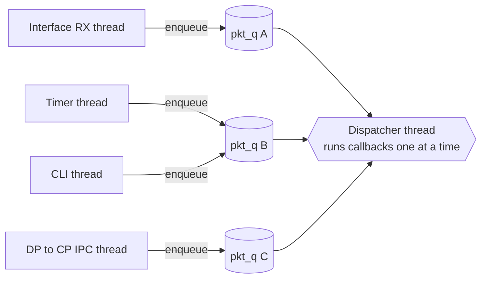
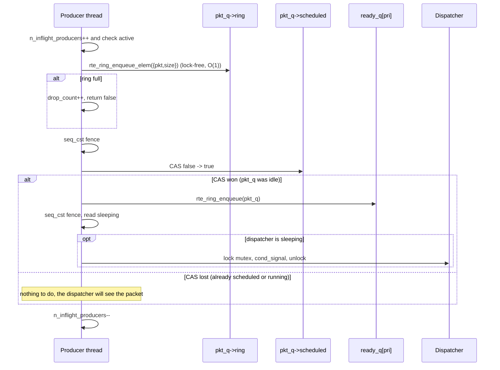

# Lock-less Event Dispatcher: Design and Architecture

Files in this directory:

| File | What it is |
|------|------------|
| `PubLockLessEvDis.h` | **Public API** — opaque handles; application code includes only this |
| `LockLessEvDis.h` | Private struct layouts + `ll_pkt_elem_t` (library `.cpp` only) |
| `LockLessEvDis.cpp` | Implementation |
| `LockLessEvDis_test.cpp` | Self-checking demos (include `PubLockLessEvDis.h`) |
| `compile_ll.sh` | Builds `ll_ev_dis_test.exe` |
| `event_dispatcher.h/.c` | The **original** dispatcher, left unchanged, for comparison |

---

## 1. What problem does an Event Dispatcher solve?

A router has many sources of work: packets arriving on interfaces, timers
firing, CLI commands, IPC messages from the data plane. If every source ran
its handler on its own thread, every shared data structure (routing table,
ARP table, BGP RIB...) would need locks. That leads to deadlocks, races and
slow code.

The Event Dispatcher solves this with one rule:

> **All application handlers run on ONE thread, one after another.**

Other threads never touch application state. They only *hand work over* to
the dispatcher thread by enqueueing a packet into a **packet queue (pkt_q)**.
The dispatcher wakes up, picks the most important pkt_q that has packets, and
calls that pkt_q's callback. Because only one callback runs at a time,
application code needs no locks at all.

This is a classic **Multi-Producer, Single-Consumer (MPSC)** problem:



Many producers, one consumer. Getting packets from producers to the consumer
quickly and safely is the whole job.

---

## 2. Why re-implement it? Limitations of the original

The original (`event_dispatcher.c`) is correct, but its hot path is full of
locks and allocations:

| On every `pkt_q_enqueue()` the original... | Cost |
|---|---|
| takes `pkt_q->q_spinlock` | producers serialize on the spinlock |
| `calloc()`s a `pkt_t` wrapper node | malloc lock + cache misses; `free()` later |
| takes `ev_dis_mutex` (inside `event_dispatcher_schedule_task`) | producers **and** the dispatcher fight for one mutex |
| calls `pthread_cond_signal()` even if the dispatcher is busy | possible system call per packet |

On every `task_get_next_pkt()` the dispatcher takes the spinlock again and
calls `free()`.

When producers contend for a lock, the thread holding it can be preempted.
Everyone else then waits, including the dispatcher, which stalls the whole
control plane (a *lock convoy*).

### The goals of the new design

1. Use **DPDK lock-less queues** (`rte_ring`) instead of glthread lists.
2. Insertion and deletion in queues must be **O(1)**.
3. Keep the **same priority levels** and scheduling order.
4. **No `task_t`.** The pkt_q itself is what gets scheduled.
5. Keep **only the pkt_q APIs**. The `task_create_*` APIs are removed.
6. Solve the **multiple-producer, single-consumer** problem.
7. Keep **Wait/Signal**: the dispatcher sleeps when idle and is woken up.
8. **Retain the base design**: same callback model, same drain loop, same
   cooperative yielding.

---

## 3. Architecture at a glance

```
                       PRODUCER THREADS (any number)
        ┌──────────────┬──────────────┬──────────────┐
        │ thread T1    │ thread T2    │ thread T3    │
        └──────┬───────┴──────┬───────┴──────┬───────┘
               │ ll_pkt_q_enqueue()  (lock-free, O(1))
               ▼              ▼              ▼
   ┌──────────────────┐ ┌──────────────────┐ ┌──────────────────┐
   │ pkt_q A (pri 0)  │ │ pkt_q B (pri 1)  │ │ pkt_q C (pri 1)  │
   │ rte_ring MPSC    │ │ rte_ring MPSC    │ │ rte_ring MPSC    │
   │ [pkt|pkt|pkt| ]  │ │ [pkt|   |   | ]  │ │ [pkt|pkt|   | ]  │
   │ scheduled = 1    │ │ scheduled = 1    │ │ scheduled = 1    │
   └────────┬─────────┘ └────────┬─────────┘ └────────┬─────────┘
            │ first packet flips scheduled 0->1 and pushes the
            │ pkt_q POINTER into the ready queue of its priority
            ▼                    ▼                    ▼
   ┌─────────────────────────────────────────────────────────────┐
   │ EVENT DISPATCHER                                            │
   │  ready_q[0] CRITICAL   : [ &A ]           rte_ring MPSC     │
   │  ready_q[1] HIGH       : [ &B, &C ]       rte_ring MPSC     │
   │  ready_q[2] MEDIUM     : [ ]                                │
   │  ready_q[3] LOW_MEDIUM : [ ]                                │
   │  ready_q[4] LOW        : [ ]                                │
   │  ready_q[5] VERY_LOW   : [ ]                                │
   │                                                             │
   │  sleeping (atomic) + mutex + condvar   <-- Wait / Signal    │
   └──────────────────────────┬──────────────────────────────────┘
                              │ dequeue highest priority first
                              ▼
                 ┌─────────────────────────┐
                 │ DISPATCHER THREAD       │
                 │ (the single consumer)   │
                 │  cbk(ev_dis, pkt_q, sz) │
                 │   while(pkt = ll_task_  │
                 │     get_next_pkt()) ... │
                 └─────────────────────────┘
```

There are **two levels of queues**, and both are DPDK rings:

| Queue | Element | Producers | Consumer |
|---|---|---|---|
| `pkt_q->ring` (one per pkt_q) | `ll_pkt_elem_t {char *pkt; uint32_t size}` (16 bytes, stored **by value**) | application threads | dispatcher, inside the callback |
| `ev_dis->ready_q[pri]` (one per priority) | `ll_pkt_q_t *` | application threads (first packet only) and the dispatcher (re-schedule) | dispatcher main loop |

In the original, the "ready queue" held `task_t` objects and every pkt_q
owned a hidden `task_t`. Here, the ready queue holds **pkt_q pointers
directly**, so `task_t` is gone.

---

## 4. A short primer on DPDK `rte_ring`

`rte_ring` is a fixed-size circular buffer. It has two pairs of indices,
one pair for the producer side and one for the consumer side:

```
          cons.tail    cons.head            prod.tail    prod.head
              │            │                    │            │
              ▼            ▼                    ▼            ▼
  ┌────┬────┬────┬────┬────┬────┬────┬────┬────┬────┬────┬────┐
  │    │    │ X  │ X  │ X  │ X  │ X  │ X  │ X  │ w  │    │    │
  └────┴────┴────┴────┴────┴────┴────┴────┴────┴────┴────┴────┘
                                                 ▲
                                    slot reserved by a producer, being written
```

**Multi-producer enqueue, in three steps:**

1. **Reserve.** A compare-and-swap (CAS) on `prod.head` moves it forward by
   `n`. If two producers race, one CAS fails and that producer retries. The
   winner now *owns* those slots, and nobody else will write them.
2. **Copy.** Write the elements into the reserved slots. No synchronization
   is needed because the slots are exclusively owned.
3. **Publish.** Move `prod.tail` forward so the consumer can see the new
   elements.

**Single-consumer dequeue** (`RING_F_SC_DEQ`) is even simpler. Only one
thread ever moves `cons.head`/`cons.tail`, so it needs **no atomic
read-modify-write at all**, only correctly ordered loads and stores.

Because both indices only move forward and wrap with a mask, enqueue and
dequeue are **O(1)**. Nothing is allocated, and no lock is held at any point.

### 4.1 Element rings (`rte_ring_*_elem`)

Classic rings store `void *`. The **elem** API stores fixed-size elements
of any size that is a multiple of 4 bytes. We store
`{char *pkt; uint32_t pkt_size; uint32_t pad}` (16 bytes) directly in the
ring, which is why there is **no per-packet `malloc()`**. The original
allocated a `pkt_t` glue node for every packet.

### 4.2 Exact size (`RING_F_EXACT_SZ`)

Normally a ring's size must be a power of two, and it holds `size - 1`
elements. With `RING_F_EXACT_SZ`, DPDK rounds up internally and exposes
exactly the capacity you asked for, here 500 packets (same as the original
`PKT_Q_MAX_QUEUE_SIZE`).

### 4.3 No EAL required

`rte_ring_create()` allocates from DPDK hugepage memory and needs
`rte_eal_init()`. The tcpip_stack control plane is not a DPDK application,
so `ll_ring_alloc()` allocates cache-line aligned memory with
`posix_memalign()` and calls `rte_ring_init()` to format it. It is the same
ring with the same algorithms, without the EAL.

### 4.4 Is `rte_ring` really lock-free? (an important lesson)

Look at step 3 of the enqueue again. Producers must publish in **order**.
If producer P1 reserved slot 7 and P2 reserved slot 8, P2 cannot move
`prod.tail` past 8 until P1 has moved it past 7. In classic MP mode, P2
**busy-waits** for P1.

If P1 is **preempted by the OS** between reserving and publishing, P2, P3
and P4 all spin, burning their whole time slice while P1 is not even
running. With more producer threads than CPUs, this becomes a near-livelock.

**We measured it** with demo 3 (4 producers, 2.4 M packets) on this machine:

| Producer sync mode | 24 CPUs | 4 CPUs | 1 CPU |
|---|---|---|---|
| classic MP (`0`) | 8.0 Mpps | **hung (killed after 30 s)** | **hung** |
| RTS (`RING_F_MP_RTS_ENQ`) | 8.8 Mpps | 4.2 Mpps | 0.7 Mpps |
| HTS (`RING_F_MP_HTS_ENQ`) | 8.7 Mpps | 4.7 Mpps | 1.0 Mpps |

DPDK added two modes for preemptible environments:

* **RTS (Relaxed Tail Sync).** Producers do not wait for each other in
  order. The *last* producer to finish moves the tail for everyone. A
  preempted producer delays publication of its own slot, but it does not
  make others spin.
* **HTS (Head/Tail Sync).** Head and tail move together, so only one
  producer is in flight at a time.

DPDK applications pin one thread per dedicated core, so classic MP is
fine there. **tcpip_stack threads are ordinary, preemptible pthreads**, so
this library uses **RTS by default** (`LL_RING_PROD_SYNC_FLAG` in
`LockLessEvDis.cpp`). You can rebuild with
`EXTRA_CFLAGS="-DLL_RING_PROD_SYNC_FLAG=0" ./compile_ll.sh` and run
`taskset -c 0 ./ll_ev_dis_test.exe 3` to watch the classic mode hang.

> Lesson for students: "lock-free" algorithms can still *wait*. Always ask
> what happens if a thread is descheduled at the worst possible instruction.

---

## 5. Data structures

### 5.1 `ll_pkt_q_t`

```c
struct ll_pkt_q_ {
    /* Init-only (written before publication, read freely afterwards) */
    struct rte_ring *ring;          /* MPSC ring of ll_pkt_elem_t          */
    ll_event_dispatcher_t *ev_dis;
    ll_event_cbk cbk;               /* NULL => passive queue                */
    ll_task_priority_t priority;
    void (*free_cbk)(void *);

    /* Shared: producers + dispatcher */
    std::atomic<bool>     active;               /* accepting packets?       */
    std::atomic<uint32_t> n_inflight_producers; /* for safe deletion        */
    std::atomic<bool>     scheduled;            /* THE scheduling flag      */
    std::atomic<uint32_t> drop_count;

    /* Dispatcher thread only */
    uint64_t deq_count;
    uint32_t no_of_invocations;
};
```

### 5.2 `ll_event_dispatcher_t` (key fields)

```c
struct ll_event_dispatcher_ {
    struct rte_ring *ready_q[LL_TASK_PRIORITY_MAX]; /* MPSC rings of pkt_q*  */

    pthread_mutex_t   ev_dis_mutex;      /* only for sleep/wake + deletion   */
    pthread_cond_t    ev_dis_cond_wait;
    std::atomic<bool> sleeping;          /* producers lock mutex only if set */

    pthread_mutex_t   ctrl_mutex;        /* registry of pkt_qs (control plane)*/
    ll_pkt_q_t       *pkt_q_list[LL_EV_DIS_MAX_PKT_Q];

    std::atomic<ll_pkt_q_t *> del_req;   /* "please detach this pkt_q"       */
    pthread_cond_t    del_done_cond;

    ll_pkt_q_t       *current_pkt_q;     /* whose callback is running        */
    ...
};
```

Notice the comments in the header group every field by **who writes it**.
This is a good habit for concurrent code: for each field, you should be
able to say which threads write it and which read it.

---

## 6. The `scheduled` flag: the heart of the design

In the original, a pkt_q's hidden `task_t` was linked into a ready list. To
avoid adding it twice, the scheduler took `ev_dis_mutex` and checked
`IS_GLTHREAD_LIST_EMPTY(&task->glue)`.

We replace that check with one atomic boolean per pkt_q:

> `scheduled == true` means the pkt_q's pointer is in a ready queue **or**
> its callback is running right now.

**Rule:** only the thread that changes `scheduled` from `false` to `true`
with a CAS may push the pkt_q into a ready queue.

```c
bool expected = false;
if (!pkt_q->scheduled.compare_exchange_strong(expected, true))
    return;                       /* someone else owns scheduling: done   */
rte_ring_enqueue(ev_dis->ready_q[pkt_q->priority], pkt_q);
ll_ev_dis_wakeup(ev_dis);
```

Consequences:

* **Invariant:** each pkt_q appears **at most once** across all ready
  queues.
* So a ready queue never holds more than `LL_EV_DIS_MAX_PKT_Q` entries,
  and it is sized to exactly that. **A ready-queue enqueue can never fail.**
* With 1000 packets arriving in a burst, only the first producer does the
  CAS-and-push. The other 999 see `scheduled == true`, return immediately,
  and only pay for the ring enqueue.

---

## 7. Producer path: `ll_pkt_q_enqueue()`



The **only** time a producer can touch a mutex is when it is the first
producer for an idle pkt_q **and** the dispatcher is asleep. Under load the
dispatcher is never asleep, so the hot path is entirely lock-free.

---

## 8. Consumer path: the dispatcher thread

```c
while (!stop_req) {
    if (del_req) service_del_req();               /* rare, control plane */

    pkt_q = get_next_pkt_q_to_run();              /* priority scan, O(1) */
    if (!pkt_q) { wait_for_work(); continue; }    /* WAIT                */

    current_pkt_q = pkt_q;
    pkt_q->cbk(ev_dis, pkt_q, sizeof(*pkt_q));    /* app drains packets  */

    if (current_pkt_q == NULL) continue;          /* deleted itself      */
    current_pkt_q = NULL;
    post_call(pkt_q);                             /* re-schedule if needed */
}
```

### 8.1 Priority (unchanged semantics)

`get_next_pkt_q_to_run()` tries `ready_q[0]` (CRITICAL), then
`ready_q[1]`, and so on down to `ready_q[5]`. That is at most 6 O(1)
dequeue attempts, regardless of how many pkt_qs or packets exist.

* A higher priority pkt_q is **always** served before a lower one.
* Inside one priority, service is **round-robin**. A pkt_q that still has
  packets after its callback returns goes back to the **tail** of its ready
  queue.

As in the original, scheduling is **cooperative**. A running callback is
never interrupted. Long callbacks should check
`ll_event_dispatcher_should_suspend()` (500 ms by default) or process a
fixed budget of packets, then return.

Demo 2 shows this. The dispatcher is kept busy while packets are enqueued
to a LOW, then MEDIUM, then CRITICAL queue. Once it is free, it serves them
as **C, M, L**.

### 8.2 The re-schedule race (and why no packet is ever stranded)

When a callback returns, `post_call()` runs:

```c
pkt_q->scheduled.store(false);          /* (1) give up ownership           */
atomic_thread_fence(seq_cst);           /* (2)                              */
if (!rte_ring_empty(pkt_q->ring))       /* (3) anything left?               */
    ll_pkt_q_schedule(ev_dis, pkt_q);   /*     CAS + push                  */
```

The danger is a producer that enqueues a packet *while the callback is
running*. Its CAS fails (`scheduled` is still true), so it does not schedule
the pkt_q and relies on the dispatcher. Consider the two orders:

| Order of events | Outcome |
|---|---|
| Producer's CAS happens **before** (1) | CAS fails. Then (3) runs after the producer's enqueue, sees the packet and re-schedules. ✔ |
| Producer's CAS happens **after** (1) | CAS succeeds and the producer schedules the pkt_q. If (3) also sees the packet, its own CAS fails, so the pkt_q is pushed only once. ✔ |

The two fences (producer: *enqueue → fence → CAS*; dispatcher:
*store → fence → check*) guarantee that **at least one side sees the other's
write**. This is the classic **store-buffering** pattern; without the fences,
a CPU could reorder each side's load ahead of its store, and both could miss.

---

## 9. Wait / Signal without a lock on the fast path

The dispatcher must sleep when there is nothing to do; spinning would burn a
CPU. Producers must wake it up, and a **lost wake-up** (dispatcher goes to
sleep right after a producer added work) must be impossible.

The original solved this by having every producer take `ev_dis_mutex`. We
use an atomic `sleeping` flag and take the mutex only when needed.

**Dispatcher** (`ll_ev_dis_wait_for_work`):

```c
lock(mutex);
sleeping = true;
fence(seq_cst);
while (no stop && no del_req && all ready queues empty)
    cond_wait(cond, mutex);           /* atomically releases mutex */
sleeping = false;
unlock(mutex);
```

**Producer** (`ll_ev_dis_wakeup`), after pushing into a ready queue:

```c
fence(seq_cst);
if (sleeping) { lock(mutex); cond_signal(cond); unlock(mutex); }
```

**Why no wake-up is lost:**

1. This is the same store-buffering pattern. The producer *writes ring,
   then reads `sleeping`*, and the dispatcher *writes `sleeping`, then reads
   ring*. With fences on both sides, at least one of them sees the other.
   * If the dispatcher sees the non-empty ring, it does not sleep. ✔
   * If the producer sees `sleeping == true`, it goes to signal. ✔
2. The dispatcher holds the mutex continuously from `sleeping = true` until
   `cond_wait` atomically releases it. So the producer's `lock(mutex)`
   succeeds only once the dispatcher is truly waiting, and the signal lands. ✔

Demo 4 shows the dispatcher asleep (`state=IDLE sleeping=1`) after 100 ms
with no work, and one signal per wake-up afterwards. In the stress test you
will see `signals sent > signals received`. Several producers can observe
`sleeping == true` at the same moment and all signal. That is harmless:
extra signals to a non-waiting condvar are no-ops.

---

## 10. Deleting a pkt_q safely: `ll_de_init_pkt_q()`

Deletion is the hardest part of any lock-free structure. Once
`ll_de_init_pkt_q()` returns, the application may free the pkt_q's memory,
so **no thread may touch it afterwards**. Three kinds of thread might:

| Who might still reference the pkt_q | How we stop it |
|---|---|
| A producer inside `ll_pkt_q_enqueue()` | **Step 1**: `active = false`, then wait for `n_inflight_producers == 0` |
| A ready queue holding its pointer | **Step 2**: the consumer rotates that ready queue and drops the pointer |
| The dispatcher running its callback | **Step 2**: detach happens only between callbacks, or sets `current_pkt_q = NULL` when called from inside its own callback |

**Step 1, fencing off producers.** This is store-buffering once more:

```
Producer : n_inflight++   ; fence ; if (!active) back off
Deleter  : active = false ; fence ; wait until n_inflight == 0
```

After the deleter sees zero, every producer has either finished or will see
`active == false`.

**Step 2, removing from the ready queue.** A ring cannot delete from the
middle. Since only the consumer may dequeue, the consumer pops every entry
currently present and pushes back all of them except the deleted pkt_q.
This is O(number of pkt_qs), but it only runs on deletion, a rare control
plane event, and never on the packet path. Who does it?

* **Dispatcher not running**: the caller does it directly (no consumer exists).
* **Called on the dispatcher thread** (from inside a callback): it does it
  directly. If it deleted the pkt_q whose callback is running,
  `current_pkt_q` is set to `NULL` so the main loop does not touch it again.
* **Called on any other thread**: it posts the pkt_q in `del_req`, signals
  the dispatcher, and waits on `del_done_cond`. The dispatcher services
  the request between callbacks.

**Steps 3 and 4.** The pkt_q is unregistered. Packets still in its ring are
freed with `free_cbk` if set (otherwise left for the application), and the ring memory is released.

Demo 5 deletes a pkt_q while 4 producers are hammering it and checks:
`accepted == consumed by callback + freed by de_init`. Every packet is
handled exactly once, with no leaks and no double frees.

---

## 11. Complexity summary

| Operation | Original | Lock-less |
|---|---|---|
| Enqueue a packet | O(1) + spinlock + `calloc` + mutex | **O(1)**, lock-free, no allocation |
| Dequeue a packet | O(1) + spinlock + `free` | **O(1)**, no atomic RMW (single consumer) |
| Schedule a pkt_q | O(1) + mutex | **O(1)**, one CAS, only on idle→ready |
| Pick next pkt_q | O(priorities) under mutex | **O(priorities)** = 6 ring dequeues, no lock |
| Wake dispatcher | mutex + signal every time | lock + signal **only if asleep** |
| Delete a pkt_q | O(1) list unlink under locks | O(#pkt_qs) once (control plane only) |

---

## 12. Memory-ordering cheat sheet

Every correctness argument in this design reduces to one of two patterns.

**Release/acquire (publication):** "everything I wrote before X is visible
to whoever sees X".

* `ll_init_pkt_q()` initializes all fields, then does `active.store(true, release)`.
* Inside `rte_ring`, a producer writes the element, then stores `prod.tail`
  (release). The consumer loads `prod.tail` (acquire), then reads the element.

**Store-buffering (Dekker), which needs seq_cst fences on both sides:**
"I write A then read B; you write B then read A; at least one of us must
see the other's write".

| Where | Thread 1 writes → reads | Thread 2 writes → reads |
|---|---|---|
| Lost-wake-up prevention | producer: ready ring → `sleeping` | dispatcher: `sleeping` → ready rings |
| Re-schedule race | producer: pkt ring → `scheduled` (CAS) | dispatcher: `scheduled` → pkt ring |
| Safe deletion | producer: `n_inflight` → `active` | deleter: `active` → `n_inflight` |

Release/acquire is **not** enough for store-buffering. Even x86 reorders a
later load ahead of an earlier store, so a full fence (`mfence` / locked
instruction) is required.

---

## 13. API mapping: original to lock-less

| Original | Lock-less | Notes |
|---|---|---|
| `event_dispatcher_t` | `ll_event_dispatcher_t` | |
| `pkt_q_t` | `ll_pkt_q_t` | |
| `event_cbk` | `ll_event_cbk` | same signature |
| `task_priority_t`, `TASK_PRIORITY_*` | `ll_task_priority_t`, `LL_TASK_PRIORITY_*` | same levels and aliases |
| `event_dispatcher_init(ev, name)` | `ll_event_dispatcher_init(ev, name [, core_id])` | returns `bool`; `core_id` defaults to 0 |
| `event_dispatcher_run(ev, pin, core)` | `ll_event_dispatcher_run(ev)` | always pins to `core_id` from init |
| — | `ll_event_dispatcher_stop(ev)`, `ll_event_dispatcher_destroy(ev)` | new: clean shutdown |
| `init_pkt_q(ev, q, cbk)` | `ll_init_pkt_q(ev, q, cbk [, priority [, free_fn]])` | priority defaults to `PKT_PROCESSING`; `free_fn` NULL => leftover data not freed; returns `bool` |
| `de_init_pkt_q(q)` | `ll_de_init_pkt_q(q)` | safe under concurrent producers |
| `pkt_q_enqueue(ev, q, pkt, sz)` | `ll_pkt_q_enqueue(ev, q, pkt, sz)` | lock-free |
| `task_get_next_pkt(ev, &sz)` | `ll_task_get_next_pkt(ev, &sz)` | |
| `ptk_q_drop_count(q)` | `ll_ptk_q_drop_count(q)` | |
| `event_dispatcher_should_suspend(ev)` | `ll_event_dispatcher_should_suspend(ev)` | |
| `eve_dis_get_current_task(ev)` | `ll_eve_dis_get_current_pkt_q(ev)` | no `task_t` any more |
| `scheduler_task_queue(ev)` | `ll_scheduler_task_queue(ev)` | prints ready queues and pkt_qs |
| `task_create_new_job*`, `task_cancel_job`, `task_schedule_again` | **removed** | pkt_q APIs only |

Migrating a callback is mostly a rename:

```c
/* Before */
static void bgp_route_pkt_q_cbk(event_dispatcher_t *ev_dis, void *arg, uint32_t sz) {
    uint32_t data_size;
    info = (bgp_route_processing_info_t *)task_get_next_pkt(ev_dis, &data_size);
    for (; info; info = (...)task_get_next_pkt(ev_dis, &data_size)) { ... }
}

/* After */
static void bgp_route_pkt_q_cbk(ll_event_dispatcher_t *ev_dis, void *arg, uint32_t sz) {
    uint32_t data_size;
    info = (bgp_route_processing_info_t *)ll_task_get_next_pkt(ev_dis, &data_size);
    for (; info; info = (...)ll_task_get_next_pkt(ev_dis, &data_size)) { ... }
}
```

---

## 14. Building and running the demos

```bash
cd libs/EventDispatcher
./compile_ll.sh                 # needs: pkg-config --modversion libdpdk
./ll_ev_dis_test.exe            # all demos
./ll_ev_dis_test.exe 3          # only the MPSC stress demo
```

| Demo | What it proves |
|---|---|
| 1. Basic usage | API walk-through, a port of `main_pkt_q.c` |
| 2. Priority | Queues are served CRITICAL → MEDIUM → LOW regardless of enqueue order |
| 3. MPSC stress | 4 producers × 3 queues × 200k pkts: **zero loss, per-producer FIFO kept**, drop accounting exact, throughput |
| 4. Wait / Signal | Dispatcher sleeps when idle (no spinning), one signal per wake-up |
| 5. Delete under load | `ll_de_init_pkt_q()` races 4 producers: every packet consumed or freed exactly once |

Sample output (24-core machine):

```
=== Demo 2 : Priority ===
    dispatcher is busy in blocker callback; enqueueing L, M, C
    [dispatcher] served queue 'C'
    [dispatcher] served queue 'M'
    [dispatcher] served queue 'L'
    service order = CML (expected CML)
    PASS

=== Demo 3 : 4 producers x 3 queues x 200000 pkts (MPSC stress) ===
    packets received  : 2400000 / 2400000
    FIFO violations   : 0
    queue-full drops  : 34732 (all retried by producers)
    callbacks invoked : 69412
    signals sent/rcvd : 3114 / 1143
    throughput        : 8.00 Mpps
    PASS

=== Demo 5 : ll_de_init_pkt_q() while 4 producers are enqueueing ===
    accepted by enqueue    : 4058
    consumed by callback   : 3584
    freed by de_init       : 474
    PASS (every accepted packet was either consumed or freed exactly once)
```

Useful build variations:

```bash
EXTRA_CFLAGS="-DLL_EV_DIS_DEBUG" ./compile_ll.sh                    # trace every decision
EXTRA_CFLAGS="-DLL_RING_PROD_SYNC_FLAG=0" ./compile_ll.sh           # classic MP ring (see §4.4)
EXTRA_CFLAGS="-fsanitize=address,undefined" ./compile_ll.sh         # (link with the same flag)
taskset -c 0 ./ll_ev_dis_test.exe                                   # everything on one CPU
```

---

## 15. Limitations and design trade-offs

* **Bounded queues.** A pkt_q holds at most 500 packets, and a dispatcher
  supports at most `LL_EV_DIS_MAX_PKT_Q` (128) pkt_qs. Rings are fixed
  size; this is the price of no allocation. A full queue drops the
  enqueue, exactly like the original.
* **Cooperative scheduling.** A callback that never returns blocks
  everything, same as the original.
* **`n_inflight_producers` is a shared counter.** Every enqueue does one
  atomic add and one atomic subtract on it. That is the cost of safe
  deletion; an application that never deletes pkt_qs under load could drop
  it. Production systems use RCU or epoch-based reclamation instead.
* **Control-plane operations still lock.** `ll_init_pkt_q()`,
  `ll_de_init_pkt_q()` and `ll_scheduler_task_queue()` use mutexes, which is
  fine because they are rare.
* **The header is C++** (`std::atomic`). C callers need a thin wrapper.

---

## 16. Exercises for students

1. Remove the `std::atomic_thread_fence` in `ll_eve_dis_process_pkt_q_post_call()`.
   Explain, with an interleaving, how a packet could be stranded forever.
2. Change `ll_ev_dis_wakeup()` to signal **without** taking the mutex. Find
   the interleaving that loses a wake-up.
3. Build with `-DLL_RING_PROD_SYNC_FLAG=0` and run demo 3 under
   `taskset -c 0`. Explain why it hangs, using the head/tail picture in §4.
4. Add `ll_task_get_next_pkt_burst()` using `rte_ring_dequeue_burst_elem()`
   and measure the throughput change.
5. Why must ready queues be sized to `LL_EV_DIS_MAX_PKT_Q` and not smaller?
   What would happen to `ll_pkt_q_schedule()` if an enqueue could fail?
6. Replace `n_inflight_producers` with an RCU-style grace period
   (`rte_rcu_qsbr`) and compare the throughput.
